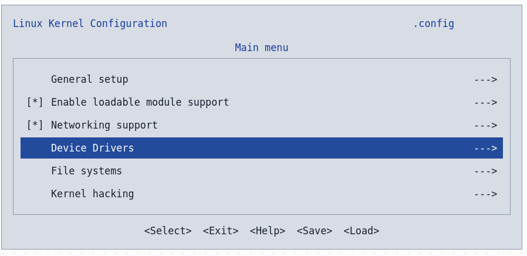
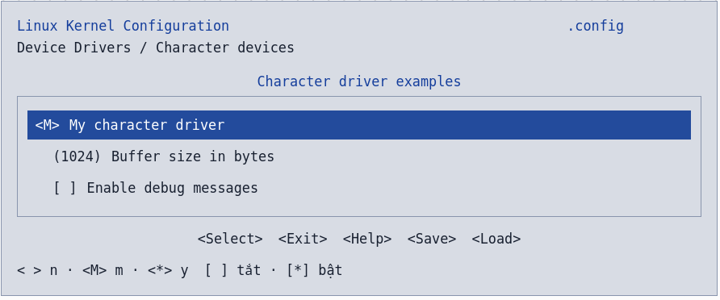

# Build in tree module

- Build in-tree nghĩa là tích hợp mã nguồn module vào hệ thống build của cây mã nguồn kernel. Khi build kernel, Kbuild dựa trên cấu hình để quyết định có biên dịch module đó hay không và biên dịch theo dạng nào.
- Các thành phần 

| Thành phần | Vai trò |
|---|---|
| File `.c` | Chứa mã nguồn module. |
| `Kconfig` | Khai báo tùy chọn cấu hình cho module. |
| `.config` | Lưu lựa chọn cấu hình hiện tại của bạn. |
| `Makefile` | Cho Kbuild biết phải biên dịch những file nào dựa trên cấu hình. |

- Cấu trúc folder
```
hello_lkm
├── hello_kernel_module.c
├── Kconfig
└── Makefile
```
- Đưa module vào kernel tree
``` sh
~/KERNEL/drivers/<my_driver>/* 
```
- Tích hợp vào hệ thống chung của Kernel
``` sh
# nano ~/KERNEL/drivers/Kconfig
source "drivers/my_driver/Kconfig"
# nano ~/KERNEL/drivers/Makefile
obj-y += my_driver/
```
- run menuconfig > Device Drivers > <tristate_info> > y/n
``` sh
make menuconfig
```



- compile modules
``` sh
make modules
```
## Các thành phần trong Kconfig

### kiểu dữ liệu

| Kiểu | Giá trị |
|---|---|
| `bool` | `y`, `n` |
| `tristate` | `y`, `m`, `n`; trạng thái `m` cần hỗ trợ module |
| `int` | Số nguyên thập phân |
| `hex` | Số thập lục phân |
| `string` | Chuỗi ký tự |


### Từ khóa tổ chức cấu hình

| Thành phần | Chức năng |
|---|---|
| `config NAME` | Khai báo một symbol cấu hình. |
| `menuconfig NAME` | Khai báo symbol làm mục cha cho các tùy chọn con. |
| `menu "..."` / `endmenu` | Gom các mục vào một menu. |
| `mainmenu "..."` | Đặt tiêu đề giao diện cấu hình. |
| `source "path/Kconfig"` | Đọc thêm một file Kconfig. |
| `if CONDITION` / `endif` | Thêm điều kiện phụ thuộc cho các mục trong khối. |
| `choice` / `endchoice` | Tạo nhóm lựa chọn loại trừ nhau. |
| `comment "..."` | Hiển thị một dòng chú thích trong menu. |

### Thuộc tính của một tùy chọn

| Thành phần | Chức năng |
|---|---|
| `bool`, `tristate`, `int`, `hex`, `string` | Kiểu dữ liệu. |
| `prompt "..."` | Dòng chữ hiển thị trong menu. |
| `default VALUE` | Giá trị mặc định. |
| `depends on EXPR` | Điều kiện phụ thuộc, giới hạn các giá trị được phép chọn. |
| `select OTHER` | Kéo theo kích hoạt symbol khác. |
| `imply OTHER` | Gợi ý kích hoạt symbol khác, cho phép từ chối. |
| `range MIN MAX` | Giới hạn giá trị cho `int` hoặc `hex`. |
| `help` | Nội dung trợ giúp. |
