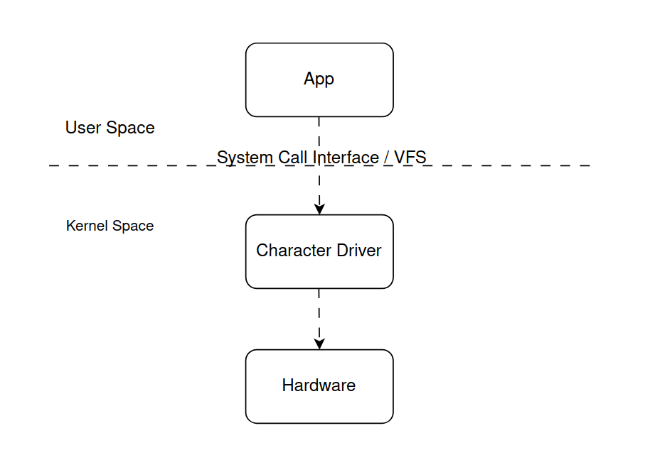

# Character driver

## I. Giới thiệu chung

- Character Driver (trình điều khiển thiết bị ký tự) là một loại Linux device driver cho phép chương trình ở không gian người dùng (User Space) giao tiếp với thiết bị hoặc tài nguyên thông qua giao diện đọc/ghi dữ liệu theo luồng byte.

Character Driver hoạt động như thế nào?



## II. Cách viết character driver cơ bản
- Cấp phát device number
- Đăng ký cdev vào kernel
- Tạo class trong /sys/
- Tạo device node

### 1. Cấp phát device number
- `include/linux/kdev_t.h`
#### Cấp phát tĩnh
```
/** 
	from: Số hiệu thiết bị cụ thể do bạn tự tạo ra (thường kết hợp bằng hàm MKDEV(major, minor)).
	count: Số lượng thiết bị liên tiếp.
	name: Tên thiết bị trong /proc/devices 
 **/
int register_chrdev_region(dev_t from, unsigned int count, const char *name);
```

``` C
dev_t dev_num;
dev_num = MKDEV(240, 0); 
register_chrdev_region(dev_num, 1, "my_device");
```

#### Cấp phát động
- Cấp phát động trong __init 
``` C
/**
 * @brief: một hàm trong Linux Kernel dùng để đăng ký ngả (range) số thiết bị ký tự một cách động, thay vì phải chỉ định cố định major number trong mã nguồn
 * dev_t *dev	Con trỏ tới biến dev_t để nhận kết quả: chứa cả major và minor đầu tiên.
 * baseminor	Số minor đầu tiên trong dải bạn muốn cấp (thường là 0).
 * count	Số lượng thiết bị ký tự (số minor number) bạn cần cấp.
 * name	Tên chuỗi để hiển thị trong /proc/devices hoặc các công cụ chẩn đoán.
 **/
int alloc_chrdev_region(dev_t *dev, unsigned baseminor, unsigned count, const char *name);
```
- Huy cấp phát trong __exit
``` C
/**
 * @brief: hàm kernel dùng để hủy đăng ký (giải phóng) vùng số thiết bị (device number region) mà bạn đã cấp phát trướ
 * @param[in]: from đại diện cho major & minor bắt đầu (thường được trả về bởi alloc_chrdev_region() hoặc tạo bằng MKDEV(major, minor))
 * @param[in]: count: Số lượng minor number bạn muốn hủy đăng ký (giống như lúc bạn đã đăng ký)
**/
void unregister_chrdev_region(dev_t from, unsigned count);
```
#### Lấy thông tin devuce number

``` C
int minor_no = MINOR(device_number);
int major_no = MAJOR(device_number);
```
### 2. Đăng ký cdev
- `include/linux/cdev.h`
#### Liên kết cấu trúc cdev với file_operations
``` C
/**
 * @brief: khởi tạo một cấu trúc cdev
 * @param[in]cdev: Con trỏ tới struct cdev (biến đại diện cho thiết bị ký tự).
 * @param[in]fops: Con trỏ tới cấu trúc file_operations chứa các hàm xử lý file operations như open, read, write...
*/
void cdev_init(struct cdev *cdev, const struct file_operations *fops);
```

##### File_operations
- Cấu trúc chứa các con trỏ hàm mà kernel sử dụng để gọi những hàm xử lý của driver khi chương trình user space thao tác với thiết bị.
``` C
static const struct file_operations fops = {
    .owner   = THIS_MODULE,
    .open    = drv_open,
    .release = drv_release,
    .read    = drv_read,
    .write   = drv_write,
    .llseek  = drv_llseek, 
    // ....
};
```
- Khi một tiến trình ở User Space gọi các hàm tiêu chuẩn như open(), read(), write(), hay close() trên file thiết bị "/dev/my_device", VFS (Virtual File System) sẽ tra cứu bảng fops của driver này để biết hàm nào trong Kernel cần được thực thi.
###### open
``` C
static int drv_open(struct inode *inode, struct file *file) 
{
    pr_info("open was successful\n");
    return 0;
}
```
###### release
``` C
static int drv_release(struct inode *inode, struct file *file)
{
    pr_info("release was successful\n");
    return 0;
}
```
###### read
``` C
static ssize_t drv_read(struct file *file, char __user *buf, size_t len, loff_t *offset) 
{
    pr_info("Read requested for %zu bytes \n",count);
	pr_info("Current file position = %lld\n",*f_pos);

    if((*f_pos + count) > DEV_MEM_SIZE)
		count = DEV_MEM_SIZE - *f_pos;

    if(copy_to_user(buff,&device_buffer[*f_pos],count)){
		return -EFAULT;
	}

    *f_pos += count;

	pr_info("Number of bytes successfully read = %zu\n",count);
	pr_info("Updated file position = %lld\n",*f_pos);

    return count;
}
```
- copy_to_user: đẩy dữ liệu từ bộ đệm của kernel lên bộ đệm mà ứng dụng yêu cầu.
``` C
/**
 * to: Con trỏ phía User-space (__user *) nhận dữ liệu.
 * from: Con trỏ phía Kernel-space chứa dữ liệu nguồn (ví dụ: mảng device_buffer của bạn).
 * n: Số lượng byte cần sao chép.
 * @retval:  = 0: Sao chép thành công toàn bộ số byte yêu cầu.
 *          != 0: Số lượng byte chưa thể sao chép do lỗi vùng nhớ
*/
unsigned long copy_to_user(void __user *to, const void *from, unsigned long n);
```
###### write
``` C
ssize_t drv_write(struct file *filp, const char __user *buff, size_t count, loff_t *f_pos)
{
	pr_info("Write requested for %zu bytes\n",count);
	pr_info("Current file position = %lld\n",*f_pos);

	if((*f_pos + count) > DEV_MEM_SIZE)
		count = DEV_MEM_SIZE - *f_pos;

	if(!count){
		pr_err("No space left on the device \n");
		return -ENOMEM;
	}

	if(copy_from_user(&device_buffer[*f_pos],buff,count)){
		return -EFAULT;
	}

	*f_pos += count;

	pr_info("Number of bytes successfully written = %zu\n",count);
	pr_info("Updated file position = %lld\n",*f_pos);

	return count;
}
```
- copy_from_user: hận dữ liệu từ ứng dụng user-space gửi xuống lưu vào bộ đệm của driver.
``` C
/**
 * to: Con trỏ phía Kernel-space nhận dữ liệu
 * from: Con trỏ phía User-space (__user *) nhận dữ liệu.
 * n: Số lượng byte cần sao chép.
 * @retval:  = 0: Sao chép thành công toàn bộ số byte yêu cầu.
 *          != 0: Số lượng byte chưa thể sao chép do lỗi vùng nhớ
*/
unsigned long copy_from_user(void *to, const void __user *from, unsigned long n);
```

###### llseek
``` C
static loff_t drv_llseek(struct file *file, loff_t offset, int whence){
    loff_t new_pos;
    switch (whence) {
        case SEEK_SET:
            new_pos = offset;
            break;

        case SEEK_CUR:
            new_pos = file->f_pos + offset;
            break;

        case SEEK_END:
            new_pos = data_len + offset;
            break;

        default:
            return -EINVAL;
    }
    if (new_pos < 0 || new_pos > BUFFER_SIZE) {
        return -EINVAL; 
    }
    file->f_pos = new_pos;
    pr_info("New value of the file position = %lld\n", new_pos);
    return new_pos;
}
```


#### Đăng ký Character Device vào kernel VFS
``` C
/**
 * @brief: đăng ký character device vào hệ thống thiết bị (device model) của Linux.
 * @param[in] p: Con trỏ tới struct cdev đã được khởi tạo (thường bằng cdev_init()).
 * @param[in] dev: Số thiết bị (device number), thường là kết quả của MKDEV(major, minor), hoặc alloc_chrdev_region() cấp
 * @param[in] count: Số lượng minor devices mà driver này quản lý bắt đầu từ dev. Thường là 1 cho driver đơn giản. 
 * @retval: < 0 false
*/
int cdev_add(struct cdev *p, dev_t dev, unsigned count);
```

#### Hủy cấp phát trong cdev 
``` C
cdev_del(struct cdev_t *cdev);
```
### 3. Tạo class trong /sys/

#### Cấp phát động class
```C
/**
 * @brief: tạo một "class" thiết bị trong /sys/class, nhằm hỗ trợ việc tạo device node tự động trong /dev
 * @param[in] owner: Thường là THIS_MODULE, chỉ ra module nào sở hữu class này. 
 * @param[in] name: Tên class, sẽ hiển thị trong /sys/class/<name>/.
 * @retval: == NULL -> false
*/
struct class *class_create(struct module *owner, const char *name);
```
#### Hủy cấp phát
``` C
void class_destroy(struct class *cls);
```

#### Kiểm tra kết quả
``` sh
ls /sys/class/my_char_driver
```

### 4. Tạo device node
-`include/linux/device.h`
#### Cấp phát động device node
``` C
/**
 * @param[in] class:	Con trỏ tới class mà bạn đã tạo từ class_create().
 * @param[in] parent:	Thiết bị cha, thường là NULL nếu không có.
 * @param[in] devt:	Device number (dev_t), chứa major và minor number
 * @param[in] drvdata:	Con trỏ dữ liệu riêng của driver, có thể là NULL hoặc struct của bạn.
 * @param[in] fmt: , ...	Format string để đặt tên thiết bị (ví dụ "mydevice%d", ...)
*/
struct device *device_create(struct class *class, struct device *parent,
                             dev_t devt, void *drvdata, const char *fmt, ...);
```
#### Hủy cấp phát 
``` C
void device_destroy(struct class *class, dev_t devt);
```

#### Kiểm tra kết quả
``` sh
ls /dev/my_char_driver
```

cat /npro
