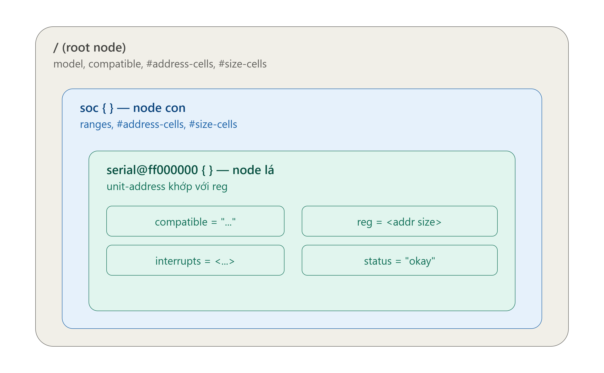
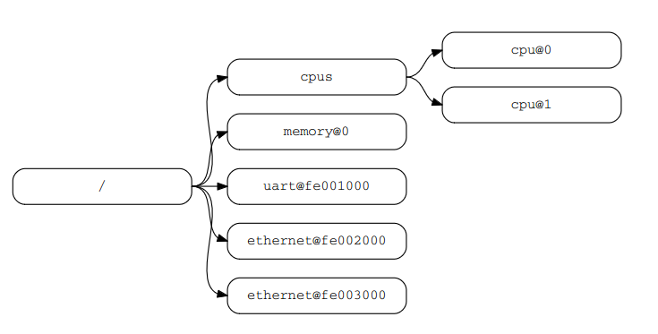

# Device tree

## Introduction to the device tree
- Device Tree là một cấu trúc dữ liệu mô tả phần cứng (CPU, bus, thiết bị ngoại vi, địa chỉ, ngắt...) dưới dạng cây, tách biệt khỏi mã nguồn kernel — thay vì phải hard-code thông tin board vào file C như trước đây (arch/arm/mach-*/board-xxx.c), kernel Linux đọc thông tin phần cứng từ file này lúc boot.

## Syntax 


```
/dts-v1/;                          // khai báo phiên bản DT

#include "soc-common.dtsi"         // include file dùng chung

/ {                                 // root node
    model = "My ARM Board";
    compatible = "vendor,my-board";
    #address-cells = <1>;
    #size-cells = <1>;

    soc {                           // node con, không có unit-address
        compatible = "simple-bus";
        ranges;
        #address-cells = <1>;
        #size-cells = <1>;

        serial0: serial@ff000000 {     // label: node-name@unit-address
            compatible = "vendor,uart-v1";
            reg = <0xff000000 0x1000>;
            interrupt-parent = <&gic>;
            interrupts = <0 53 4>;
            clocks = <&clk_uart>;
            status = "okay";
        };
    };

    aliases {
        serial0 = &serial0;         // tham chiếu qua phandle-label
    };
};
```
### 1. Cấu trúc Cây & Tên Node (Node Naming)


- Devicetree được tổ chức dưới dạng danh sách liên kết phân cấp gồm các node (nút). Mỗi node đại diện cho một thiết bị phần cứng, một bus hoặc một thành phần logic.
- cú pháp đặt tên Node:
``` dts
node-name@unit-address
# node-name: Tên tổng quát mô tả chức năng của thiết bị (ví dụ: cpu, memory, serial, ethernet, display)
# unit-address: Địa chỉ cơ sở (base address) dùng để truy cập thiết bị. Địa chỉ này phải tương ứng với địa chỉ đầu tiên được khai báo trong thuộc tính reg của node đó. thành phần này 
# Note: Nếu node không có thuộc tính reg (hoặc không gắn với địa chỉ cụ thể), phần @unit-address có thể được bỏ qua.
```

### Các thộc tính và kiểu dữ liệu
#### data type


### Thuộc tính chuẩn
- compatible
    - Chức năng: Thuộc tính quan trọng nhất dùng để ghép nối (match) thiết bị với driver tương ứng.

    - Định dạng: "vendor,model" (tên nhà sản xuất + tên dòng sản phẩm).
- \#address-cells và \#size-cells

    - Chức năng: Được đặt tại node cha để quy định cách các node con khai báo vùng địa chỉ trong thuộc tính reg.
    - \#address-cells: Số lượng ô 32-bit dùng để biểu diễn địa chỉ.

    - \#size-cells: Số lượng ô 32-bit dùng để biểu diễn kích thước (độ dài vùng nhớ).
- reg
    - Chức năng: Chứa danh sách các cặp (Địa chỉ, Độ dài) mô tả không gian thanh ghi hoặc bộ nhớ mà thiết bị chiếm dụng.
    - Định dạng: Được giải mã dựa theo #address-cells và #size-cells của node cha.

- status
    - Chức năng: Cho biết trạng thái hoạt động của thiết bị. Các giá trị tiêu chuẩn:
        - "okay": Thiết bị đang hoạt động bình thường.
        - "disabled": Thiết bị hiện bị tắt (driver sẽ bỏ qua).
        - "fail": Thiết bị gặp lỗi không thể khởi tạo.

- Thuộc tính không chuẩn 
```
[tiền tố ], tên thuộc tính = giá trị
# vd: org,size = <1024>, icm,id = <0x68>
```


### đường dẫn
/node-name-1/node-name-2/node-name-N

## Binding giữa platform dirver với device tree 
- file pcd.dtsi(giải định một node của device tree).
``` dts
/{
    pcdev1: pcdev-1 {
		compatible = "pcdev-E1x","pcdev-A1x";
		org,size = <512>;
		org,device-serial-num = "PCDEV1ABC123";
		org,perm = <0x11>;
	};
}
```
- pcd driver 
``` C
#include<linux/of.h>
#include<linux/of_device.h>

// .... code

struct of_device_id org_pcdev_dt_match[] =
{
	{.name = "pcdev-A1x",.driver_data = PCDEVA1X},
	{.name = "pcdev-B1x",.driver_data = PCDEVB1X},
    // ... node tiếp theo
	{/*Null termination */}
}

struct platform_driver pcd_platform_driver = 
{
	.probe = pcd_platform_driver_probe,
	.remove = pcd_platform_driver_remove,
	// ...
	.driver = {
        // ...
		.of_match_table = of_match_ptr(org_pcdev_dt_match) // thêm device vào table matching
	}
};

int pcd_platform_driver_probe(struct platform_device *pdev)
{
    // code ...
}

int pcd_platform_driver_remove(struct platform_device *pdev)
{
    // code ...
}

static int __init pcd_platform_driver_init(void)
{
    platform_driver_register(&pcd_platform_driver);
}
static int __init pcd_platform_driver_cleanup(void)
{
    platform_driver_unregister(&pcd_platform_driver);
}

module_init(pcd_platform_driver_init);
module_exit(pcd_platform_driver_cleanup);

MODULE_LICENSE("GPL");
MODULE_AUTHOR("Kiran Nayak");
MODULE_DESCRIPTION("A pseudo character platform driver which handles n platform pcdevs");

```

## Overlays

```
/dts-v1/;
/plugin/;                              // đánh dấu đây là overlay, không phải dtb đầy đủ

/ {
    fragment@0 {
        target = <&i2c1>;              // trỏ tới node đích trong base dtb (qua phandle)
        // hoặc target-path = "/soc/i2c@ff020000";

        __overlay__ {
            status = "okay";           // bật node vốn đang disabled

            temp_sensor: sensor@48 {
                compatible = "vendor,tmp102";
                reg = <0x48>;
                status = "okay";
            };
        };
    };
};
```


## Kernel API

void *of_device_get_match_data(const struct device *dev);

of_match_device()

of_property_read_*()


CONFIG_OF
```
#ifdef CONFIG_OF
#define of_match_ptr(_ptr) (_ptr)
#else
#define of_match_ptr(_ptr) NULL
#endif
```


## Compiler
- Compile device tree 
``` shell
# ~/bb-kernel/KERNEL
make ARCH=arm CROSS_COMPILE=arm-linux-gnueabihf- dtbs
# đổi dtbs thành các file biên dịch trong devicetree board
```
- Compile overlay
```
# Biên dịch dts -> dtb
dtc -@ -I dts -O dtb -o overlay.dtbo overlay.dts
```


