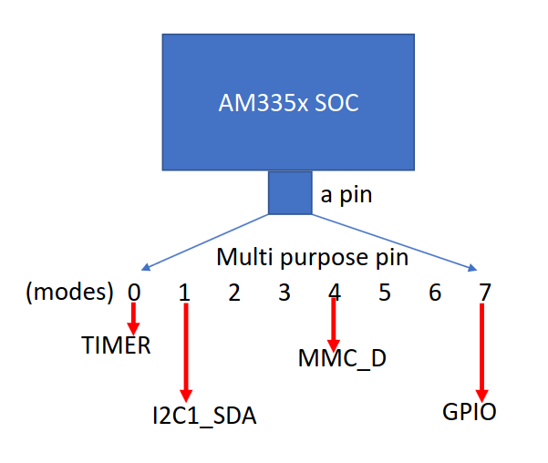
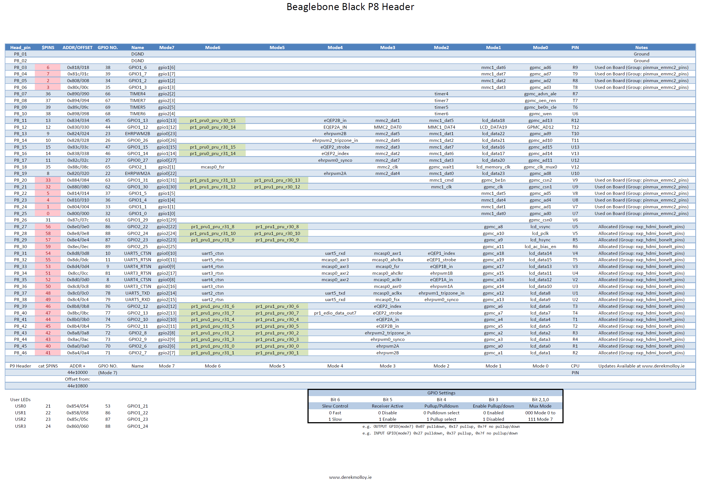
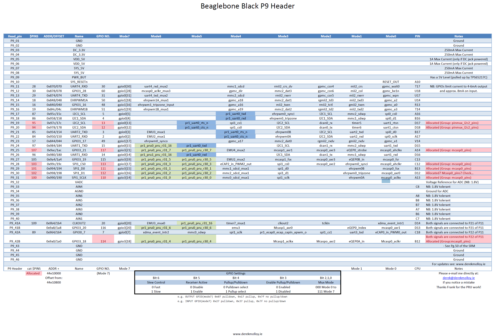
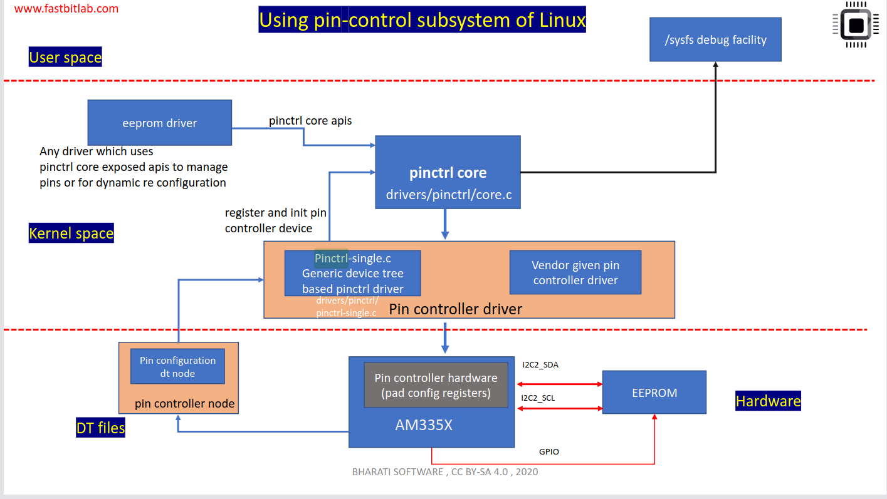
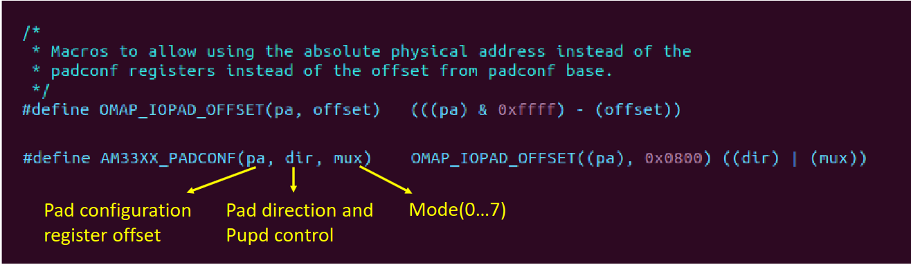
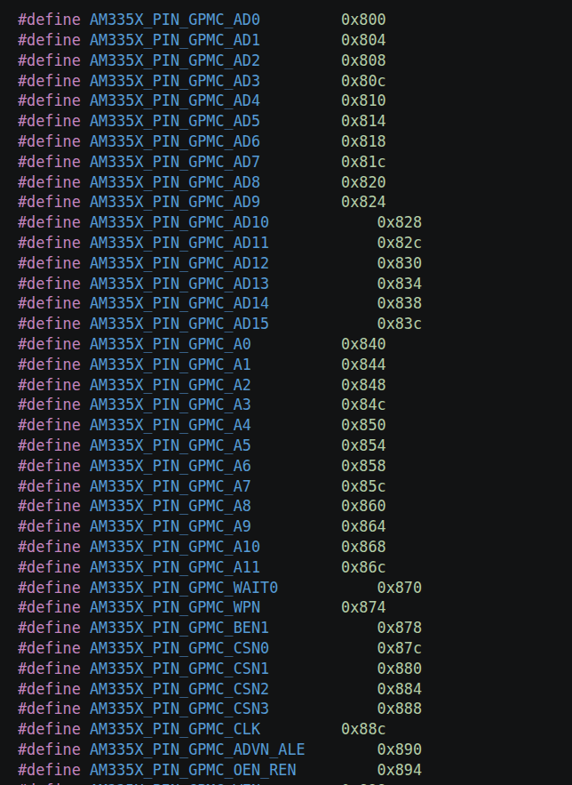
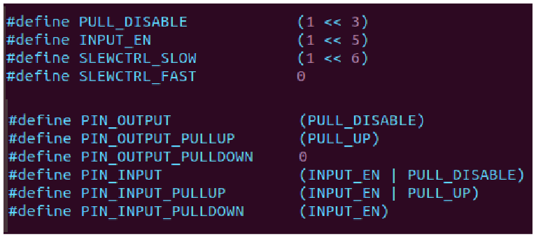

# Pin control subsystem
## I. Giới thiệu chung 
- pinctrl (Pin Control) là hệ thống của kernel dùng để chọn chức năng và cấu hình cho các chân của chip.
- pinctrl có hai nhiệm vụ chính:
  - Pinmux: chọn chân làm GPIO, UART, SPI, I²C, PWM… tùy chức năng phần cứng mà chân đó hỗ trợ.
  - Pin configuration: cấu hình điện trở kéo lên/kéo xuống (pull-up/pull-down), bộ đệm đầu vào và các đặc tính điện khác

### 1. Pinmux
- Mỗi pin io của bbb được sử dụng với nhiều chức năng khác nhau. Chức năng của một chân cắm phụ thuộc vào chế độ được thiết lập cho nó trong thanh ghi cấu hình chế độ/chân cắm.


- Pin header tren board



### 2. Pin configuration


## II. Pin control subsystem



### Pin state

### 1. Pin controller node
- Documentation/devicetree/bindings/pinctrl/pinctrl-single.txt
``` dtb
am33xx_pinmux: pinmux@800 {
    compatible = "pinctrl-single";
    reg = <0x800 0x238>;
    /* ... */
};
```
### 2. Pin configuration node
``` dtb
&am33xx_pinmux{
    sensor_i2c_pins: pinmux_i2c2_pins{
    pinctrl-single,pins=<
        AM33XX_PADCONF(AM335X_PIN_UART1_RTSN, PIN_INPUT_PULLUP, MUX_MODE2); # I2C_SCL
        AM33XX_PADCONF(AM335X_PIN_UART0_CTSN, PIN_INPUT_PULLUP, MUX_MODE2); # I2C_SDA
    >;
    };
};

&i2c2 {
    /* ... */
    pinctrl-names = "default";
    pinctrl-0 = <&sensor_i2c_pins>;
};
```

### 3. Macro
- Kernel cung cấp macro đăng ký pin config cho các pin. 
  - /KERNEL/include/bt-bindings/pinctrl/omap.h
  - /KERNEL/include/bt-bindings/pinctrl/am33xx.h


- Pad configuration register offset

- Pad direction and pupd control

- mode: MUX_MODE<0-7>
